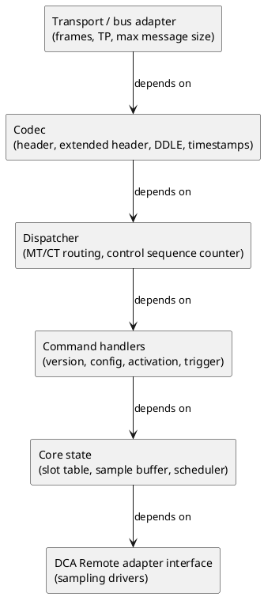

# Development View — VDP Server

The development view describes how the **VDP Server** (VDP-CM Remote) source code is
organised, the module boundaries, and developer-facing concerns. It maps the logical
components (see [logical view](../logical%20view/README.md)) onto code modules.

> The application lives under
> [apps/vehicle-data-protocol-server](../../apps/vehicle-data-protocol-server). This
> document defines the intended module structure so the implementation stays aligned
> with the AUTOSAR VDP specification in [standards/](../../standards).

## 1. Layering

Dependencies point downward only. The codec and core state modules have no dependency
on the transport, so they can be unit-tested in isolation.

## 2. Suggested module layout

| Module | Responsibility | Logical component |
|--------|----------------|-------------------|
| `transport/` | Bus/transport-protocol integration; enforce `VDP.maxMessageSize`; no segmentation of its own. `[FO_PRS_VDP_00040]` | (infrastructure) |
| `codec/` | Encode/decode headers and payloads; little-endian; `DDLE[UINT]`; VDP relative timestamp. `[FO_PRS_VDP_00001..00004]` | Message Codec |
| `dispatch/` | Parse `MT`/`CT`; validate and mirror the control sequence counter; emit protocol error messages for malformed requests. `[FO_PRS_VDP_00007..00015]`, `[FO_PRS_VDP_00120..00126]` | Message Dispatcher |
| `commands/version` | Protocol version request/response. `[FO_PRS_VDP_00020..00023]` | Protocol Version Handler |
| `commands/config` | Add/remove dynamic configuration; slot validation; persistency. `[FO_PRS_VDP_00024..00069]`, `[FO_PRS_VDP_00127..00146]` | Configuration Manager |
| `commands/activation` | Activate/deactivate slots; partial-error handling. `[FO_PRS_VDP_00067..00080]` | Activation Controller |
| `commands/trigger` | Sampling and transmission triggers. `[FO_PRS_VDP_00081..00090]` | Trigger Handler |
| `core/slots` | Slot table, VDP settings, collection settings, activation state. | domain model |
| `core/buffer` | Sample aggregation; overflow detection. `[FO_PRS_VDP_00096]`, `[FO_PRS_VDP_00118]` | Sample Buffer |
| `core/scheduler` | Transmission modes; MTDT enforcement; data sequence counter. `[FO_PRS_VDP_00027..00095]` | Transmission Scheduler |
| `core/datamsg` | Build data messages: reference timestamp + repeated DPI + async errors. `[FO_PRS_VDP_00091..00105]` | Data Message Builder |
| `errors/` | Error codes, NACK payloads, async error info. `[FO_PRS_VDP_00005..00006]`, `[FO_PRS_VDP_00017]`, `[FO_PRS_VDP_00105..00118]` | Error Reporter |
| `dca/` | DCA Remote adapter interface (activate, deactivate, trigger, receive samples). | DCA Remote Adapter |

## 3. Cross-cutting encoding rules

Implementers must apply these globally:

- **Endianness:** every VDP-specific field is little-endian. `[FO_PRS_VDP_00001]`
- **Reserved bits:** always `0`. `[FO_PRS_VDP_00138]`
- **DDLE[UINT]:** dynamic-length encoding of unsigned integers; MSB of each byte flags
  a following byte; leading zero bytes are omitted. `[FO_PRS_VDP_00003]`
- **Relative timestamp:** DDLE-encoded delta at a per-slot resolution (`TRES`), computed
  and reconstructed as specified. `[FO_PRS_VDP_00004]`, `[FO_PRS_VDP_00042]`

## 4. Configuration parameters (compile/config time)

| Parameter | Meaning | Reference |
|-----------|---------|-----------|
| `VDP.maxSlotID` | Maximum usable slot ID (`≤ 16382`). | `[FO_PRS_VDP_00146]` |
| `VDP.maxMessageSize` | Upper bound on emitted message size, derived from the transport. | `[FO_PRS_VDP_00040]` |
| `MTDT` — Minimum Transmission Distance Time | Minimum time between two data messages (anti bus-flooding). | chapter 7 |
| `MSDT` — Minimum Sampling Distance Time | Minimum time between two samples (anti CPU-blocking). | chapter 7 |

## 5. Testing strategy

| Test level | Focus |
|------------|-------|
| Unit | Codec round-trips (DDLE, timestamps, headers), slot-table transitions, error-code selection. |
| Component | Each command handler against valid and malformed requests, including all error codes allowed for that command (`[FO_PRS_VDP_00066]`, `[FO_PRS_VDP_00080]`, `[FO_PRS_VDP_00090]`, `[FO_PRS_VDP_00144]`). |
| Integration | End-to-end sequences from the [scenarios](../scenarios/README.md) against a simulated VDP-CM Proxy and stub DCA Remotes. |
| Conformance | Traceability back to `[FO_PRS_VDP_*]` items; sequence-counter and wrap-around behaviour. |

## 6. Client counterpart

The client (VDP-CM Proxy) is developed under
[apps/vehicle-data-protocol-client](../../apps/vehicle-data-protocol-client). It shares
the `codec/` encoding rules and the message/command taxonomy but implements the
requesting side. Keep the codec and shared constants consistent between the two.
