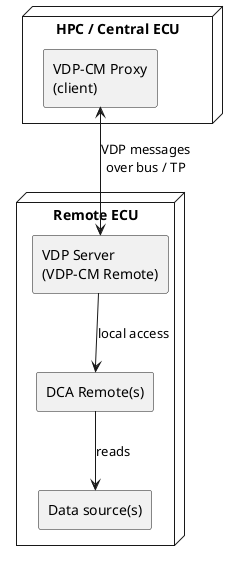

# Logical View — VDP Server

The logical view describes the functional decomposition of the **VDP Server**
(the VDP-CM Remote) into components, their responsibilities, and their relationships.
It is grounded in the AUTOSAR VDP specification (see [standards/](../../standards)) and
the [stakeholder requirements](../../requirements/stakeholder-requirements.md).

## 1. Context

The server is a **stateful** endpoint: it keeps per-connection control state and
per-slot configuration and activation state.

## 2. Component decomposition

| Component | Responsibility | Key requirements |
|-----------|----------------|------------------|
| **Message Codec** | Serialise/deserialise VDP messages (header, extended header, payload); little-endian encoding; DDLE[UINT] and relative-timestamp encoding. | `[FO_PRS_VDP_00001..00004]`, `[FO_PRS_VDP_00138]` |
| **Message Dispatcher** | Read the message type (`MT`) and command type (`CT`), route requests to the correct handler, and validate the control message sequence counter. | `[FO_PRS_VDP_00007]`, `[FO_PRS_VDP_00048]`, `[FO_PRS_VDP_00010..00015]` |
| **Protocol Version Handler** | Answer protocol version requests with main/minor version. | `[FO_PRS_VDP_00020..00023]` |
| **Configuration Manager** | Own the slot table: add/remove data-point dynamic configurations per data point, per DCA Remote, or globally; validate slot IDs; manage persistency. | `[FO_PRS_VDP_00024..00069]`, `[FO_PRS_VDP_00127..00146]` |
| **Activation Controller** | Track and change the active/inactive state of each configured slot. | `[FO_PRS_VDP_00054]`, `[FO_PRS_VDP_00055]`, `[FO_PRS_VDP_00067..00080]` |
| **Trigger Handler** | Handle sampling triggers and transmission triggers on request. | `[FO_PRS_VDP_00081..00090]`, `[FO_PRS_VDP_00119]` |
| **Sample Buffer** | Aggregate acquired samples awaiting transmission; enforce buffer limits and report overflow. | `[FO_PRS_VDP_00096]`, `[FO_PRS_VDP_00118]` |
| **Transmission Scheduler** | Decide when to emit data messages according to the transmission mode (cyclic / on-sampling / on-request / default); enforce MTDT; maintain the data sequence counter. | `[FO_PRS_VDP_00027..00029]`, `[FO_PRS_VDP_00053]`, `[FO_PRS_VDP_00092..00095]` |
| **Data Message Builder** | Assemble data messages with a reference timestamp and repeated data-point information, including asynchronous error information. | `[FO_PRS_VDP_00091..00105]` |
| **Error Reporter** | Produce not-acknowledge control responses, protocol error messages, and asynchronous errors. | `[FO_PRS_VDP_00005]`, `[FO_PRS_VDP_00006]`, `[FO_PRS_VDP_00017]`, `[FO_PRS_VDP_00105..00126]` |
| **DCA Remote Adapter interface** | Boundary through which the server activates/deactivates and triggers sampling and receives samples. DCA Remotes implement the sampling modes; the server implements the protocol and transmission. | `[FO_PRS_VDP_00085]`, guidelines chapter 8 |

## 3. Domain model

| Entity | Description | Notable fields |
|--------|-------------|----------------|
| **Slot** | A dynamically configured data point during a collection task. | `VDP_SLOT_ID` (1..`maxSlotID`), owning `DCA_REM_ID`, VDP settings, collection settings, activation state, persistency flag. |
| **DCA Remote** | Adapter that samples one class of data points. | `DCA_REM_ID` (1..16383). |
| **VDP settings (SET)** | Per-slot behaviour flags. | `TRES` timestamp resolution, `SEC`, `PERSIST`, `TXMODE_ON_SAMPLING`, `INIT_ACT`. |
| **Collection settings (COL)** | Sampling behaviour. | `SCHANGE` (on-change), `SCYCLIC` (cyclic) + `SCT` sampling cycle time. |
| **Sample (DPSI)** | A single acquired value. | `VDP_SLOT_ID`, relative timestamp, data length, data bytes. |
| **Asynchronous error (ASYNC_ERR)** | Error carried inside a data message. | marker `0xFF 0x7F`, error code, length, info. |

### Reserved identifier ranges

- **VDP Slot ID:** valid `1 .. maxSlotID`; `maxSlotID ≤ 16382`; `0` and `16383` are
  reserved; `16383` (`0xFF 0x7F`) marks asynchronous errors. `[FO_PRS_VDP_00146]`,
  `[FO_PRS_VDP_00036]`
- **DCA Remote ID:** valid `1 .. 16383`. `[FO_PRS_VDP_00031]`

## 4. Message and command taxonomy

| `MT` | Message type | Direction |
|------|--------------|-----------|
| 0 | Protocol version | request ↔ response |
| 1 | Control | request ↔ response |
| 2 | Data | server → client only |
| 3 | Error | server → client only |

| `CT` | Control command | Handled by |
|------|-----------------|------------|
| 0 | Add dynamic configuration | Configuration Manager |
| 1 | Remove dynamic configuration | Configuration Manager |
| 2 | Activation | Activation Controller |
| 3 | Trigger | Trigger Handler |

## 5. Requirement traceability (stakeholder → components)

| Stakeholder req. | Realising component(s) |
|------------------|------------------------|
| STR-02 Multi-version | Protocol Version Handler |
| STR-04/05/06 Configuration & persistency | Configuration Manager |
| STR-07 Sampling modes | Configuration Manager, DCA Remote Adapter |
| STR-08/09 Activation & interruption | Activation Controller |
| STR-10/11 Transmission & decoupling | Transmission Scheduler, Sample Buffer |
| STR-12/13 Missing-data & meta data | Data Message Builder, Message Codec |
| STR-14 Control-sequence integrity | Message Dispatcher |
| STR-15/16 Error handling | Error Reporter |
| STR-17/18/19 Size & rate limits | Transmission Scheduler, DCA Remote Adapter |
| STR-20 Secured channel | Data Message Builder |

See the [process view](../process%20view/README.md) for how these components interact at
runtime, and the [scenarios](../scenarios/README.md) for end-to-end flows.
