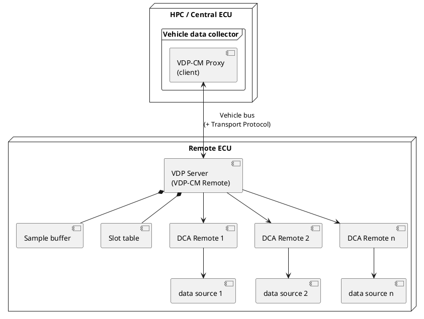

# Physical View — VDP Server

The physical view maps the **VDP Server** (VDP-CM Remote) and its collaborators onto
vehicle hardware and the communication infrastructure. It is grounded in the AUTOSAR
VDP specification in [standards/](../../standards).

## 1. Deployment topology

## 2. Nodes

| Node | Role | Notes |
|------|------|-------|
| **HPC / Central ECU** | Hosts the central data collection unit and the VDP-CM Proxy (client). | Aggregates data from many remote ECUs. |
| **Remote ECU** | Hosts the **VDP Server** and its DCA Remotes. | Typically a Classic Platform ECU with local access to data. |
| **Data sources** | Sensors, signals, or software resources on/attached to the remote ECU. | Accessed only via DCA Remotes. |

A single VDP-CM Proxy may connect to **multiple** remote ECUs; it then maintains one
control sequence counter per remote. `[FO_PRS_VDP_00010]` (see
[process view](../process%20view/README.md))

## 3. Communication channel

- VDP messages travel over a **vehicle bus** (e.g. CAN, CAN FD, Ethernet). When a
  message exceeds the bus frame size, an underlying **Transport Protocol (TP)** carries
  it; VDP performs **no segmentation** of its own. `[FO_PRS_VDP_00040]`
- **Message size bound:** every emitted message must satisfy
  `VDP.maxMessageSize ≤ min_i(TP_i.maxIPDUSize)`, or the maximum frame length if no TP is
  used. The protocol should not be used on buses whose messages are too small to hold
  multiple configurations or samples. `[FO_PRS_VDP_00040]`
- **Directionality on the wire:**
  - Data (`MT=2`) and error (`MT=3`) messages: Remote → Proxy only.
  - Control (`MT=1`) and version (`MT=0`): request Proxy → Remote, response Remote → Proxy.
  `[FO_PRS_VDP_00007]`

## 4. Security and time infrastructure

| Concern | Physical dependency | Reference |
|---------|---------------------|-----------|
| **Secured channel** | An underlying secure protocol (SecOC, TLS, IPsec, MACsec, …) when a slot requires `SEC=1`. Unsecured transmission (`SEC=0`) is always supported. | `[FO_PRS_VDP_00043..00046]` |
| **Global time** | A synchronised time base (e.g. StbM) supplies the timestamps used for `REF_TS` and relative timestamps; loss of sync produces a timebase error `0x72`. | `[FO_PRS_VDP_00097]`, `[FO_PRS_VDP_00116]` |
| **Persistency** | Non-volatile memory on the remote ECU for configurations flagged `PERSIST=1`; storage exhaustion yields error `0x78`. | `[FO_PRS_VDP_00051]`, `[FO_PRS_VDP_00052]` |

## 5. Rate-limiting parameters (deployment tuning)

| Parameter | Protects | Tuned per |
|-----------|----------|-----------|
| **MTDT** (Minimum Transmission Distance Time) | The bus, against data-message flooding. | VDP-CM Remote |
| **MSDT** (Minimum Sampling Distance Time) | The CPU, against sampling overload. | DCA Remote |

On Classic Platform ECUs the effective cyclic periods are quantised to the main function
period (e.g. `floor(TCT / MainFunctionPeriod)`). `[FO_PRS_VDP_00029]`
