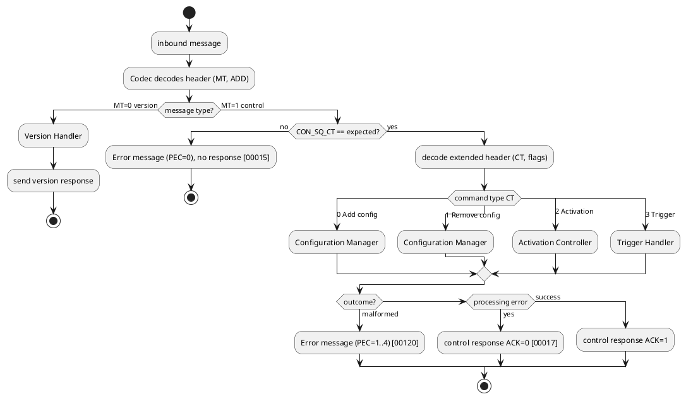

# Process View — VDP Server

The process view describes the runtime behaviour of the **VDP Server** (VDP-CM Remote):
concurrency, data flow, timing, and the decoupling of sampling from transmission. It
complements the [logical view](../logical%20view/README.md) and is realised by the
modules in the [development view](../development%20view/README.md).

## 1. Concurrent activities

The server's behaviour is driven by three loosely coupled activities:

| Activity | Trigger | Responsibility |
|----------|---------|----------------|
| **Control processing** | Inbound control/version request | Validate the control sequence counter, dispatch to a handler, apply state changes, send the response. |
| **Sampling** | Time (cyclic), value change (on-change), or trigger (on-request) | Performed by the DCA Remotes; pushes samples into the Sample Buffer. |
| **Transmission** | Time (cyclic), a marked sample (on-sampling), a trigger, or a buffer condition (default) | Build and emit data messages, honouring MTDT and the data sequence counter. |

The central design principle from the standard is the **decoupling of sampling and
transmission**: samples are buffered in the server and transmitted independently in
time. Sampling logic lives in the DCA Remotes; the protocol and transmission logic live
in the server. (See standards chapter 8.)

## 2. Control message processing pipeline

### Control message sequence counter (`CON_SQ_CT`)

- 5-bit value `0..31`, initialised to `1`, incremented per request, wraps `31 → 1`.
  `[FO_PRS_VDP_00010..00013]`
- Mirrored back in the response. `[FO_PRS_VDP_00014]`
- On an unexpected value the server sends an **error message** with `PEC = 0` carrying
  the expected counter and does **not** send a control response — this also detects an
  unexpected restart. `[FO_PRS_VDP_00015]`, `[FO_PRS_VDP_00123]`

### Acknowledge semantics

- `ACK = 1`: request fully applied; response payload empty (for activation/trigger).
- `ACK = 0`: partially or fully erroneous; the successfully applicable parts are still
  applied, and the payload lists the affected slot/DCA IDs with error codes.
  `[FO_PRS_VDP_00016]`, `[FO_PRS_VDP_00017]`, `[FO_PRS_VDP_00074]`

## 3. Sampling modes (per slot)

| Mode | Config | Runtime behaviour |
|------|--------|-------------------|
| Cyclic | `SCYCLIC=1`, `SCT` set | DCA Remote samples every `SCT` ms (≥ MSDT), independent of incoming messages. `[FO_PRS_VDP_00061]` |
| On-change | `SCHANGE=1` | DCA Remote samples when it detects a change (change definition is DCA-specific). `[FO_PRS_VDP_00057]` |
| Cyclic + on-change | both set | Both of the above. |
| On-request | both `0` | No automatic sampling; a trigger request with the slot ID causes one sample. `[FO_PRS_VDP_00085]` |

Sampling only runs while the slot is **active**. `INIT_ACT` sets the initial state; an
activation request toggles it. When deactivated, automatic sampling stops.
`[FO_PRS_VDP_00054]`, `[FO_PRS_VDP_00055]`, `[FO_PRS_VDP_00071]`, `[FO_PRS_VDP_00072]`

## 4. Transmission modes

| Mode | Config | When a data message is emitted |
|------|--------|--------------------------------|
| Cyclic | `TCYCLIC=1`, `TCT` | Every `TCT` ms (≥ MTDT). `[FO_PRS_VDP_00027..00029]` |
| On-sampling | `TXMODE_ON_SAMPLING=1` | As soon as possible after a marked slot is sampled. `[FO_PRS_VDP_00053]` |
| On-request | trigger `TX_TRIG=1` | As soon as possible after the trigger. `[FO_PRS_VDP_00082]` |
| Default | buffer condition | When a buffer condition (e.g. full) is reached. |

"As soon as possible" always respects **MTDT** and, on Classic Platform, the main
function period. The server aggregates all buffered samples — ideally for many slots —
into a single data message. `[FO_PRS_VDP_00082]`

## 5. Data message assembly and timestamps

Each data message carries:

- **Header** `MT=2`, `ADD = SQ_CT` (5-bit data sequence counter, init `1`, wraps
  `31 → 1`). `[FO_PRS_VDP_00092..00095]`
- **Reference timestamp** `REF_TS` (uint32 seconds). `[FO_PRS_VDP_00097]`
- **Repeated data-point information (DPI)**, each either:
  - a **Data Point Sample** (`VDP_SLOT_ID`, relative timestamp, length, data), or
  - an **Asynchronous Error** (marker `0xFF 0x7F`, error code, length, info).
  `[FO_PRS_VDP_00098..00105]`

Relative timestamps chain: the first DPI is relative to `REF_TS`; each subsequent DPI is
relative to the reconstructed time of the previous sample, at the slot's resolution
`TRES`. `[FO_PRS_VDP_00101]`, `[FO_PRS_VDP_00042]`

## 6. Missing-data detection

The client detects gaps two ways:

1. **Data sequence counter** discontinuity ⇒ a data message was lost.
2. **Asynchronous error information** inside the data stream ⇒ a sample failed at the
   source (e.g. sampling error `0x02`, data loss `0x03`, buffer full `0x74`).

`[FO_RS_VDP_00005]`, `[FO_PRS_VDP_00092..00095]`, `[FO_PRS_VDP_00108..00118]`

## 7. Error-handling paths

| Situation | Server output | Reference |
|-----------|---------------|-----------|
| Malformed/incorrectly serialised request | Error message `MT=3` with a protocol error code `PEC` and the original header | `[FO_PRS_VDP_00120..00126]` |
| Wrong control sequence counter | Error message `PEC=0` (no control response) | `[FO_PRS_VDP_00015]` |
| Processing failure on a valid request | Control response `ACK=0` with per-slot/DCA error codes | `[FO_PRS_VDP_00017]` |
| Failure asynchronous to any request | Asynchronous error info embedded in the next data message | `[FO_PRS_VDP_00105]` |

### Protocol error codes (`PEC`, 5-bit)

`0` control sequence counter · `1` invalid options · `2` duplicated VDP Slot ID ·
`3` incorrect number of bytes · `4` unknown message type · `5..31` reserved.
`[FO_PRS_VDP_00006]`

## 8. Rate limiting

- **MTDT** bounds the transmission rate to protect the bus. `[FO_PRS_VDP_00029]`
- **MSDT** bounds the sampling rate to protect the CPU. `[FO_PRS_VDP_00061]`

See the [scenarios](../scenarios/README.md) for concrete end-to-end sequences that
exercise these paths.
