# Scenarios — VDP Server

End-to-end scenarios that tie the [logical](../logical%20view/README.md),
[development](../development%20view/README.md), [process](../process%20view/README.md)
and [physical](../physical%20view/README.md) views together. Each scenario is grounded in
the AUTOSAR VDP specification sequences (chapter 6.4) in [standards/](../../standards).

Legend: **P** = VDP-CM Proxy (client, HPC) · **S** = VDP Server (VDP-CM Remote) ·
**D** = DCA Remote.

## S1. Query protocol version

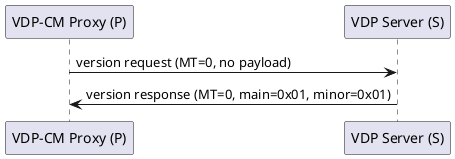

Establishes protocol compatibility before configuration. `[FO_PRS_VDP_00020..00023]`

## S2. Add data-point dynamic configurations to one DCA

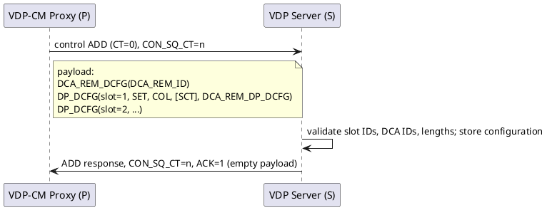

If any part fails (unknown DCA `0x76`, duplicate slot `0x79`, cyclic not supported
`0x07`, on-change not supported `0x08`, persistency limit `0x78`, …), the server applies
the valid parts and answers `ACK=0` with the affected IDs and error codes.
`[FO_PRS_VDP_00024..00069]`, `[FO_PRS_VDP_00066]`

## S3. Cyclic sampling with initial activation ON

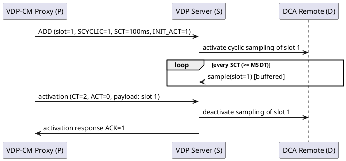

Cyclic sampling runs independently of incoming messages while the slot is active.
`[FO_PRS_VDP_00061]`, `[FO_PRS_VDP_00054]`, `[FO_PRS_VDP_00072]`

## S4. Cyclic sampling with initial activation OFF

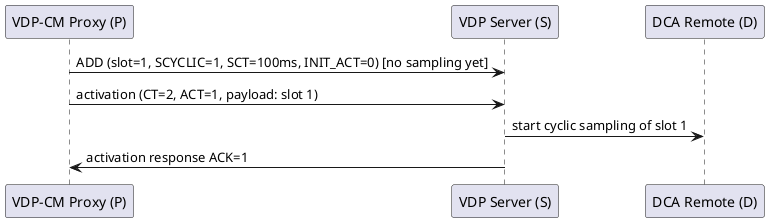

Sampling starts only after an activation request. `[FO_PRS_VDP_00055]`,
`[FO_PRS_VDP_00071]`

## S5. On-request sampling (pull)

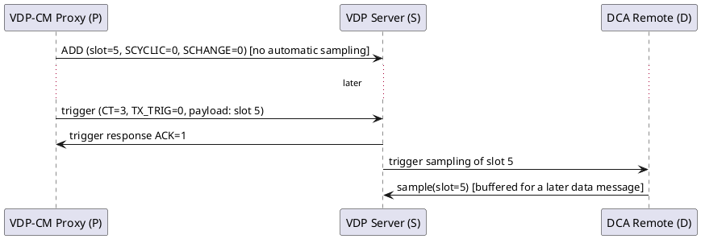

With both sampling flags `0`, the data point is sampled only on trigger.
`[FO_PRS_VDP_00085]`, `[FO_PRS_VDP_00088]`

## S6. Transmission on request (pull of buffered data)

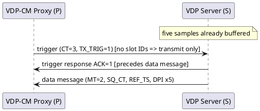

The trigger response is always sent **before** the data message.
`[FO_PRS_VDP_00082]`, `[FO_PRS_VDP_00119]`

## S7. Combined transmission + sampling trigger

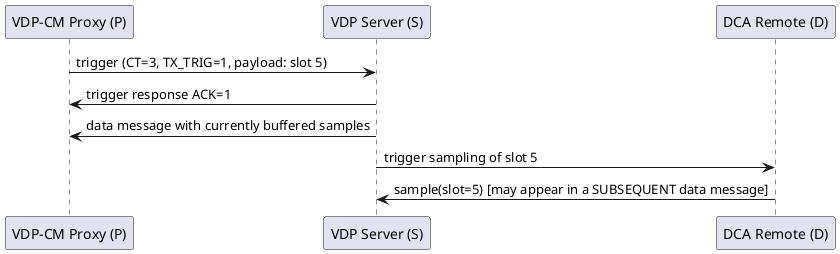

Samples acquired by the trigger need not be in the just-transmitted message; the server
may place them in a later data message (allowing it to split large results and avoid
buffer overflow). `[FO_PRS_VDP_00085]`, sequences 6.4.4.

## S8. Transmission on sampling (push)

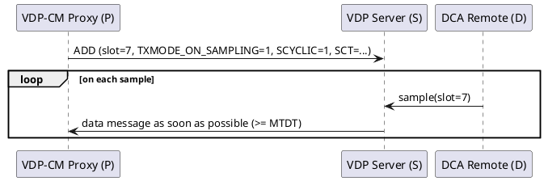

A data message is emitted as soon as possible after a marked slot is sampled.
`[FO_PRS_VDP_00053]`

## S9. Cyclic transmission

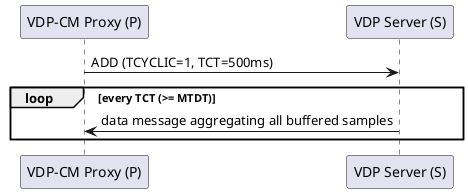

If a cyclic `TCT` is already set, a second one is rejected with error `0x7C`; remove it
first, then add the new one. `[FO_PRS_VDP_00027..00029]`, `[FO_PRS_VDP_00145]`

## S10. Remove configurations

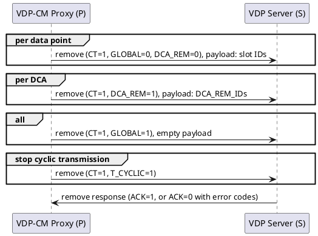

Empty payloads where content is required, or illegal flag combinations, produce protocol
error messages (`PEC=3` incorrect bytes, `PEC=5` invalid options).
`[FO_PRS_VDP_00026]`, `[FO_PRS_VDP_00069]`, `[FO_PRS_VDP_00139..00144]`

## S11. Lost control message detected

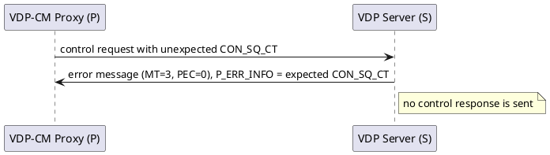

Also covers the case of an unexpected server restart. `[FO_PRS_VDP_00015]`,
`[FO_PRS_VDP_00123]`

## S12. Malformed request

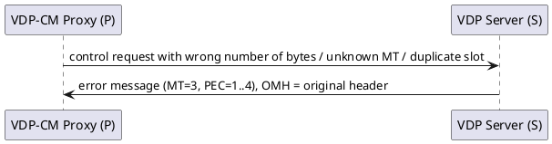

The server answers an incorrectly serialised request with an **error message**, not a
not-acknowledge. `[FO_PRS_VDP_00120..00126]`

## S13. Asynchronous sampling error

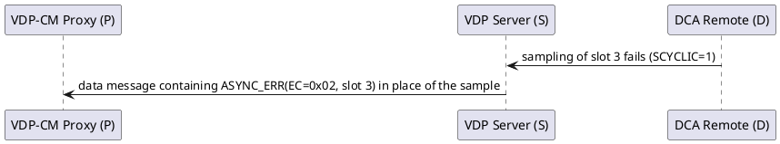

Errors that occur independently of a request are reported inside the data message as
asynchronous error information; buffer-full loss is reported once via `0x74`.
`[FO_PRS_VDP_00105]`, `[FO_PRS_VDP_00111]`, `[FO_PRS_VDP_00118]`
